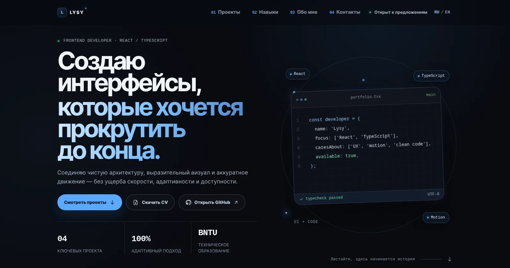

# Lysy Portfolio — redesign



Одностраничное портфолио frontend-разработчика на React и TypeScript. Редизайн построен вокруг графитово-синей палитры, крупной типографики, sticky-композиции проектов и нативных scroll-driven анимаций. В версии 2.3.1 исправлена переносимость npm lockfile; в версии 2.3 исправлено обрезание технологических бейджей в hero, добавлены новые изображения магазина и старого портфолио, а контактная форма снова отправляет сообщения напрямую через EmailJS.

## Что реализовано

- одна страница с разделами «Проекты», «Навыки», «Обо мне» и «Контакты»;
- пять проектов, включая явно помеченную архивную версию старого портфолио;
- реальные ссылки, стек и контакты из предыдущей версии сайта;
- адаптивные WebP-изображения проектов в размерах `480w`, `768w` и `1200w`;
- переключение русского и английского языков с сохранением выбора;
- адаптивная навигация и мобильное меню;
- sticky-стек проектов на desktop и безопасный обычный поток на мобильных;
- `animation-timeline: view()` для reveal-анимаций, движения изображений, линий и декоративных элементов;
- fallback через `IntersectionObserver` для браузеров без Scroll-driven Animations;
- поддержка `prefers-reduced-motion`;
- нативный индикатор прогресса на `animation-timeline: scroll()`, pointer glow и оптимизированный tilt-эффект;
- контактная форма с EmailJS, состояниями отправки, успеха и ошибки;
- готовая конфигурация публикации в GitHub Pages.

## Стек

React 19, TypeScript 6, Vite 8 и EmailJS Browser 4. Стили разделены по назначению и подключаются через единый файл `src/styles/index.css`. Runtime-библиотеки анимации и роутер не используются: для одностраничного сайта они добавили бы вес и сложность без практической пользы.

## Запуск

Требуется Node.js `^20.19.0` или `>=22.12.0`.

```bash
npm ci
npm run dev
```

Vite выведет локальный адрес приложения в терминале.

## Проверка перед публикацией

```bash
npm run check
```

Команда последовательно запускает TypeScript-проверку, ESLint и production-сборку.

Отдельные команды:

```bash
npm run typecheck
npm run lint
npm run build
npm run preview
npm run preview:prod
```

## Отправка писем

Форма использует те же EmailJS service/template/public key и имена полей, что и предыдущая версия портфолио:

```text
user_name
email
title
message
```

Текущая конфигурация уже содержит рабочие fallback-значения. Для переноса на другой EmailJS-аккаунт их можно переопределить через переменные Vite:

```bash
VITE_EMAILJS_SERVICE_ID=your_service_id
VITE_EMAILJS_TEMPLATE_ID=your_template_id
VITE_EMAILJS_PUBLIC_KEY=your_public_key
```

Клиентская интеграция находится в `src/lib/emailjs.ts`, а состояния формы — в `src/components/Contact.tsx`.

## Проверка производительности

Для Lighthouse используй production-сборку, а не dev-сервер:

```bash
npm run preview:prod
```

`npm run dev` включает HMR, React development runtime и диагностические модули, поэтому его JavaScript-вес и показатели не отражают итоговую публикацию.

Контрольный прогон оптимизаций, выполненный для версии 2.2:

| Метрика | До | После |
|---|---:|---:|
| Lighthouse Performance | 97 | 100 |
| Largest Contentful Paint | 1.7 с | 1.5 с |
| Total Blocking Time | 180 мс | 50 мс |
| Общий переданный объём | 280 КБ | 140 КБ |
| Изображения | 195 КБ | 54 КБ |

Синтетические результаты зависят от компьютера и профиля throttling. Подробности находятся в `docs/performance-report.json`. Основные оптимизации: `content-visibility: auto`, responsive images, нативный scroll timeline, немедленно видимый LCP-текст, композитные reveal-анимации и отсутствие layout-чтений в основном scroll-пути.

## Публикация в GitHub Pages

```bash
npm run deploy
```

Скрипт сначала выполняет production-сборку, а затем публикует каталог `dist` в ветку `gh-pages`. Относительный `base` в `vite.config.ts` позволяет приложению работать в подпути репозитория.

## Где менять содержимое

| Задача | Файл |
|---|---|
| Тексты RU/EN, проекты, ссылки, навыки | `src/content/siteContent.ts` |
| EmailJS-конфигурация | `src/lib/emailjs.ts` |
| Основные цвета, размеры и радиусы | `src/styles/tokens.css` |
| Scroll-driven и fallback-анимации | `src/styles/animations.css` |
| Адаптивность | `src/styles/responsive.css` |
| Скриншоты и responsive-варианты проектов | `public/projects/` |
| SEO-мета-теги | `index.html` |

## Как устроены анимации

Современный путь включается только при поддержке браузером:

```css
@supports (animation-timeline: view()) {
  .scroll-reveal {
    animation-name: view-reveal;
    animation-timeline: view();
    animation-range: entry 0% cover 16%;
  }
}
```

Контентные reveal-анимации используют opacity и движение без blur, поэтому текст остаётся резким во время прокрутки. В остальных браузерах `useRevealFallback.ts` подключает `IntersectionObserver`. При включённой системной настройке уменьшения движения переходы, scroll-анимации, marquee и декоративные вращения отключаются.

## Структура

```text
src/
├── components/   # секции и переиспользуемые UI-компоненты
├── content/      # типизированный контент и локализация
├── hooks/        # scroll, active section, reveal fallback, pointer effects
├── lib/          # EmailJS и небольшие инфраструктурные утилиты
└── styles/       # токены и стили по зонам ответственности
```

## Установка зависимостей

Проект использует публичный npm registry, закреплённый в `.npmrc`:

```text
registry=https://registry.npmjs.org/
```

Рекомендуемая чистая установка:

```bash
npm ci
```

Если проект был распакован поверх предыдущей версии, сначала удалите локальный `node_modules`, затем снова выполните `npm ci`.
